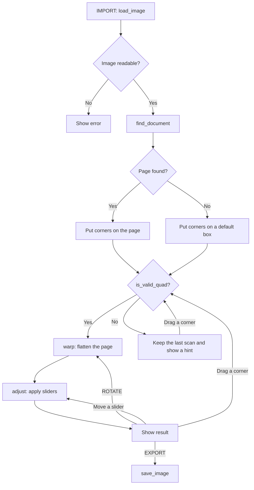
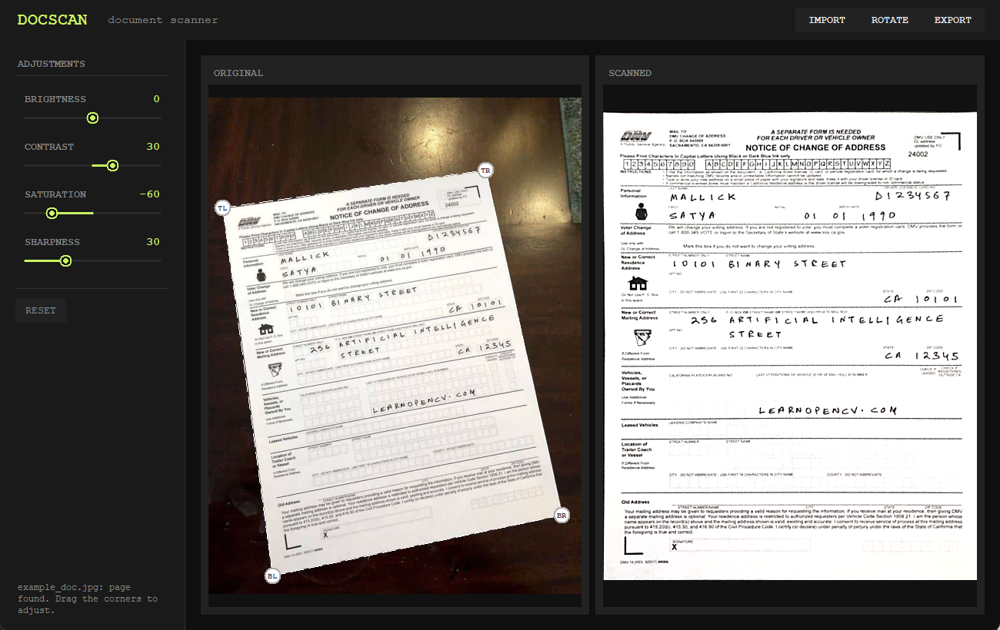

# Document Scanner

This project is designed to address the problem of needing to scan documents without a scanner.

## Get Started

1. install uv.

        pip install uv

2. clone this project and install dependencies.

        git clone https://github.com/worapon-st/document-scanner.git
        cd document-scanner
        uv sync

3. run the program

        uv run src/main.py

4. run the tests

        uv run pytest

## Build the App (Windows)

Build one file that runs without Python:

        uv run pyinstaller --noconfirm --clean --onefile --windowed --name DocScan --paths src --specpath build src/main.py

The app is saved to `dist/DocScan.exe`. It takes a few seconds to open.

## Usage

1. Open `DocScan.exe`, or run the program from source.
2. Press IMPORT and choose a photo of a document. The app finds the page and scans it.
3. If the crop is wrong, drag the 4 white corners onto the page. The result updates when you let go.
4. If the page is sideways, press ROTATE to turn it clockwise.
5. Move the sliders to adjust the result.
6. Press EXPORT and save as PNG, JPEG or a one-page PDF.

## How It Works

Image functions live in `src/docscan/core.py`. The window lives in `src/docscan/app.py`.

## Example

