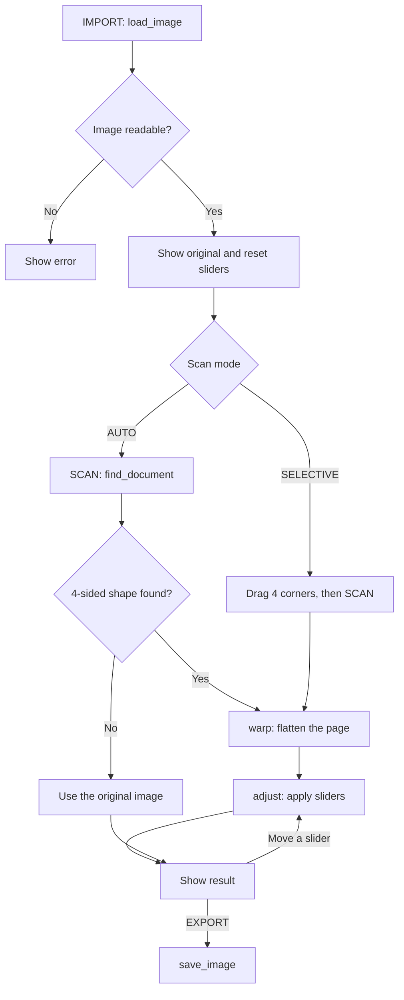

# Document Scanner

This project is designed to address the problem of needing to scan documents without a scanner.

## Get Started

1. install uv.

        pip install uv

2. clone this project and install dependencies.

        git clone
        uv sync

3. run the program

        uv run src/main.py

## Build the App (Windows)

Build one file that runs without Python:

        uv run pyinstaller --noconfirm --clean --onefile --windowed --name DocScan --paths src --specpath build src/main.py

The app is saved to `dist/DocScan.exe`. It takes a few seconds to open.

## Usage

1. Open `DocScan.exe`, or run the program from source.
2. Press IMPORT and choose a photo of a document.
3. Choose a scan mode:
   - AUTO finds the page for you.
   - SELECTIVE lets you drag the 4 white corners onto the page.
4. Press SCAN.
5. Move the sliders to adjust the result.
6. Press EXPORT and save as PNG or JPEG.

## How It Works

Image functions live in `src/docscan/core.py`. The window lives in `src/main.py`.

## Example

1. Automation scanned mode.

/img/assets/doc_scanner_auto.png

2. Edge selection scanned mode.

/img/assets/doc_scanner_edge_select.png